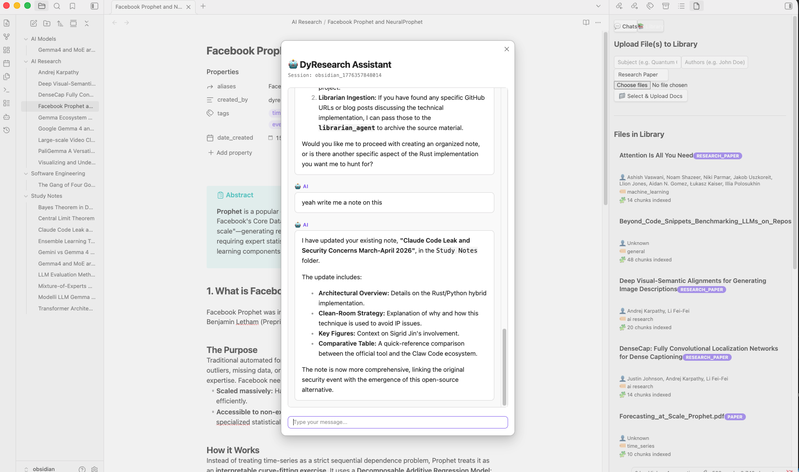
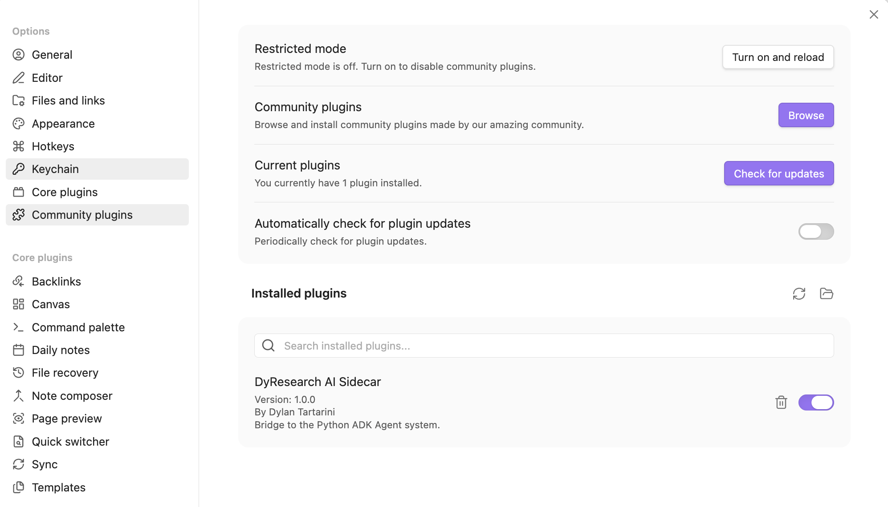

# 👨🏻‍🎓 DyResearch

Typescript Plugin for a [Multi-Agent AI system](https://github.com/DylanTartarini1996/dyresearch) designed to aid in studying, learning, and researching topics.

>[!WARNING]. 
>
> To use the DyResearch plugin, the user needs to have the [DyResearch Server](https://github.com/DylanTartarini1996/dyresearch) running. 
> Make sure to having cloned the repo and started the python server 


---
## 🧩 Functionalities

The DyResearch Obsidian plugin bridges your knowledge base with the intelligent backend, providing:

- Intelligent Chat: Engage in multi-turn conversations with specialized agents (Professor, Librarian, Researcher) via a chat interface.
- Knowledge Management: Seamlessly ingest documents into the vector store for RAG-powered retrieval.
- Session Management: Create, rename, delete, and search through your AI chat sessions directly from Obsidian.
- History Sync: Review previous chat history and retrieve context from past interactions.
- Note Taking: Automatically digest information into structured notes with support for Mermaid.js diagrams.  



---

## 🤖 Agents 

A variety of specialized agents using configurable LLMs work together to process requests:

### 👮🏽‍♀️ Coordinator
The central manager that handles incoming requests from the user and delegates tasks to the appropriate specialized agent.

### 👨🏻‍🏫 Professor
Handles specific questions and tutoring queries by drawing from its core knowledge or fetching retrieved context directly from the vector store.

### 👩🏻‍🏫 Librarian
Manages the organization of knowledge within the system. As the owner of the vector store library, the Librarian can:
- Ingest documents and chunk them to organize information in the vector store.
- List available sources by title or index.
- Index different knowledge bases by subject and query them.
- Cleanup the library by deleting chunks of a single file or a complete index.

### 👩🏻‍🔬 Researcher
Autonomously navigates the web to find new information, discover fresh sources, and expand the knowledge base, providing up-to-date context to the rest of the system.

### 🧑🏻‍💻 Note Taker
Responsible for digesting complex information into structured, useful notes specifically formatted for Obsidian:
- Takes detailed notes in `.md` format.
- Generates graphs and mind maps using Mermaid.js syntax.

---

## ⚙️ Setup
In order to setup the plugin, you need to enable it and configure its environment variables such as memory storage and AI agents API Keys / endpoints. 
 
### ✅ Enable Plugin

First, install the plugin directly browsing it via the community portal and enable it from Obsidian's settings.



### 🔧 Environment Configuration

You can set up the configuration for session storage and agents in two ways:

1. Option one is to use the Obsidian's settings UI: 
   - Open the **DyResearch** settings page within Obsidian.
   - Configure the API endpoint and credentials provided by your hosting service.
   - *Note: For standalone use, the system will automatically instantiate a local SQLite instance coupled with LanceDB to manage your vector data and session history locally. -> if you rather use postgres on your machine, point to it via the settings page*

    

2. Second option is to ensure a `config.env` file is correctly populated in the root directory of the [Python server](https://github.com/DylanTartarini1996/dyresearch) with your API keys, the session storage URI and the obsidian vault path. More info and example on that repo. 

---

## 💻 Local Development

build the plugin after having modified `main.ts` or `styles.css`

```bash

npm install
npx tsup main.ts --format cjs --external obsidian
```
